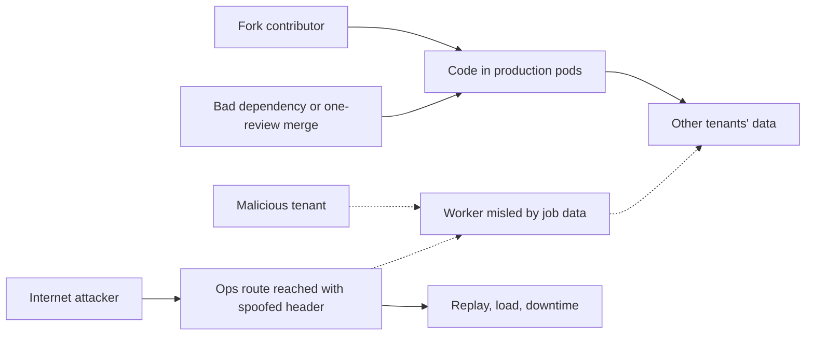

# Challenge Review: Atlas Document Processing Platform

## Notes to reviewer

This file is my review of the Atlas platform. It has my notes, the assumptions I made, the method I used to rank the risks, and the three issues I would fix first.

The `proposals/` folder holds a proposed version of the files for each issue. Each one can be compared with the provided version using `diff`, for example:

```text
diff -u Dockerfile proposals/Dockerfile
```

Links to files point to the exact lines I refer to. Line numbers are those of the files as provided.

## Summary and Relevant Context

I read every provided file by hand first. Then I ran static checks to confirm what I read and to see what the scanners add. The commands are listed so the results can be reproduced:

```text
cd challenge

hadolint Dockerfile
kubeconform -strict -summary kubernetes/
kube-linter lint kubernetes/
kube-score score kubernetes/*.yaml
trivy config .
trivy image --severity CRITICAL,HIGH node:24-alpine
checkov -d . --framework kubernetes,dockerfile,terraform
kubernetes-validate -k 1.29.0 kubernetes/api.yaml
kubernetes-validate -k 1.29.0 kubernetes/worker.yaml
```

I also checked the effective RBAC permissions of the worker manifest in a local `kind` cluster:

```text
kind create cluster --name atlas-test
kubectl create namespace atlas-production
kubectl apply -f kubernetes/worker.yaml   # Deployment failed due to missing selector; the RBAC objects still apply
kubectl auth can-i get secrets --all-namespaces \
  --as=system:serviceaccount:atlas-production:atlas-worker
kubectl auth can-i --list --as=system:serviceaccount:atlas-production:atlas-worker
```

The scanners report many items. To reduce the noise, I set aside the ones that do not affect the worst event described in the [README business context](README.md#business-context), which is unauthorized access to or modification of another customer's documents. I compared the remaining items with the intentions the README describes.

After reviewing each, 3 main hypoteses came up:

- CI workflow runs pull request code with production access, so a pull request can publish a production image ([build.yaml L5-L34](.github/workflows/build.yaml#L5-L34)).
- The load balancer accepts connections from the whole internet, so an anonymous attacker can skip the edge proxy and send the trusted header himself ([platform.ts L44-L48](infra/platform.ts#L44-L48), [README deployment behavior](README.md#deployment-behavior)).
- The worker's service account can read and list Secrets in every namespace ([worker.yaml L34-L54](kubernetes/worker.yaml#L34-L54)).

Only the first one is Critical on its own. The other two are Medium on their own. They become Critical when they are chained with the components further down the execution path, because those components hold the customers' data, which we established is the most valuable asset.

### How the findings connect

I separate the ways in from the weaknesses that widen what an attacker can reach once inside. The delivery chain is a way in. The origin bypass is a way in with limited proven reach. The missing tenant isolation widens the blast radius, so an attacker can reach other tenants’ documents.



Solid arrows are proven by the files. Dashed arrows need an application flaw that I cannot see, so I am assuming them to increase the severity level.

## Scope and Assumptions

The most important asset is the multi-tenant customer data, its documents and extracted results. I looked at how it could be read or modified, and at how an attacker could reach those paths through the supply chain, the infrastructure or the delivery pipeline.

The application code is not provided, and the [README scope](README.md#scope) places implementation details out of scope. I did not review application logic. Where a finding needs an application flaw, I assume one exists in a component that handles untrusted input, as in any real system, and I mark the assumption. A single flaw in such a component can spread widely because of the permissions described below.

Confirmed from the files and the README:

- No network policies, admission policies or edge-to-origin controls exist ([README repository map](README.md#repository-map)). Outbound traffic from the pods is therefore not restricted by any controls shown.
- The image publisher role can only work with the `atlas-api` registry repository ([platform.ts L16-L20](infra/platform.ts#L16-L20)). It cannot read the document bucket.

Assumptions:

- The worker's cloud role is not defined. Its annotation names it ([worker.yaml L7](kubernetes/worker.yaml#L7)), but `platform.ts` only defines the API role. The diagram in architecture.md shows the worker reading documents and then writing to the database, so it must have some read access. I'm assuming it covers all tenants, because one worker deployment serves every tenant and no per-job credentials are shown.
- Job messages carry a tenant or object reference. The queue's access policy is not shown, so I do not know who can send messages or how they are built.
- The integration credentials the worker reads dynamically ([worker.yaml L33](kubernetes/worker.yaml#L33)) are Kubernetes Secrets, and a job refers to at least one of them.
- What `/ops/reprocess` accepts and returns is unknown. The README only says employees use it to retry failed jobs. Relying on employee's trusted actions here might raise severity to Critical. 
- The `atlas-operations` Service selects the same pods as the API ([api.yaml L62](kubernetes/api.yaml#L62)). Pod labels are not shown in the condensed manifest, so I read this from the selector.
- The `production` tag is mutable in the registry. The README describes republishing the same tag on every build ([README deployment behavior](README.md#deployment-behavior)), which does not work with immutable tags.
- Workflows from fork pull requests start without a maintainer approval. The repository setting is not shown.
- The subject claim that a `pull_request_target` job receives is untested. I expect it to be the base branch reference. I could just script a matching pattern test with sample branch names but is not very relevant. 
- ArgoCD sync options and the mechanism behind the five-minute rollout are not shown. I am following the README statement.

### Relevant terms used in this review

- **Confused deputy:** a component with broad permissions acts for a party with narrower rights and uses its own power by mistake. See the [AWS description](https://docs.aws.amazon.com/IAM/latest/UserGuide/confused-deputy.html). 
- **`pull_request_target`:** a trigger that runs the base branch workflow with its privileges. It is meant for trusted code, and it becomes dangerous when the job executes the pull request code. See the [GitHub documentation](https://docs.github.com/en/actions/reference/security/securely-using-pull_request_target) and [GitHub Security Lab](https://securitylab.github.com/research/github-actions-preventing-pwn-requests/). 

## Principals and Trust Graph

I found seven principals. Three are personas who use or contribute to the platform: a customer, an employee and an external contributor. Four are non-human: the CI identity, the GitOps reconciler (ArgoCD), and the API and worker workload identities.

These are the trust assumptions I found, either written in the README or visible in the files.

**CI/CD pipeline**

- The `main` branch requires one approving review ([README](README.md#deployment-behavior)). No CODEOWNERS file appears in the [repository map](README.md#repository-map).
- Actions are pinned by tag, not by commit SHA ([build.yaml L20, L25](.github/workflows/build.yaml#L20)).
- `id-token: write` is set for the whole workflow ([build.yaml L11-L13](.github/workflows/build.yaml#L11-L13)).
- One job builds, tests and publishes. The build code runs in the same job that holds the publish credentials ([build.yaml L30-L34](.github/workflows/build.yaml#L30-L34), [build.sh L4-L6](scripts/build.sh#L4-L6)).
- Any repository named `platform-*` in the organization, in any workflow context, can assume the role that pushes to the production image tag ([platform.ts L3-L14](infra/platform.ts#L3-L14)).
- ArgoCD applies the manifests from `main`, and a new image under the mutable `production` tag reaches the cluster within five minutes ([README](README.md#deployment-behavior)).

**Production Kubernetes cluster**

- The API and the worker run the same image ([api.yaml L21](kubernetes/api.yaml#L21), [worker.yaml L21](kubernetes/worker.yaml#L21)).
- The API role can list, read and write the whole tenant bucket, with no tenant condition ([platform.ts L30-L35](infra/platform.ts#L30-L35)).
- The worker has a ClusterRole that can read Secrets in all namespaces ([worker.yaml L34-L54](kubernetes/worker.yaml#L34-L54)).
- The worker holds a static database password in its environment ([worker.yaml L22-L27](kubernetes/worker.yaml#L22-L27)). The database is private, but it accepts connections from every cluster node ([platform.ts L37-L42](infra/platform.ts#L37-L42)).

**Public network**

- The load balancer is internet facing and accepts HTTPS from `0.0.0.0/0` ([platform.ts L44-L48](infra/platform.ts#L44-L48)).
- The `/ops/reprocess` route trusts the `X-Edge-Authenticated` header ([README](README.md#deployment-behavior)). The ingress sends that path to the operations Service ([api.yaml L48-L53](kubernetes/api.yaml#L48-L53))

## Ranking Method

I based this review on ranking chains, not single weaknesses. For every chain I write the same five items: the access the attacker needs to start, the steps, the impact against the README's worst event, the blast radius, and what would show the attack. Confidence is written separately as verified, read from the files, or assumed.

The decision order is fixed, and the weights are stated in words:

1. **Impact counts the most.** It is measured on the README's own scale. As we already established, access to or modification of another customer's documents is the highest impact. Several hours of downtime would be serious but recoverable ([README business context](README.md#business-context)).
2. **Likelihood comes second.** It combines the access needed to start and how easy the path is to execute.
3. **Blast radius and detection decide ties.** Blast radius is how many tenants or assets are reached. Detection is what would show the attack early.
4. **Confidence does not move a chain up or down.** It limits how strongly I state the conclusion.

The scales I use(from Critical to Low):

- **Starting access:** anonymous, a customer account or a fork pull request, employee or cluster access, or an application flaw that I assume.
- **Ease:** a visible path with standard tooling, a specific condition that is easy to meet, or a condition outside the files.
- **Blast radius:** all tenants or the whole delivery pipeline, one namespace, or one resource.
- **Detection:** nothing records it, it is logged without an alert, or it is alerted within minutes.

A chain that needs an assumed application flaw is scored for impact assuming the flaw exists. Its likelihood is written as unknown. I do not average the two, because an average would hide both facts.

Ranking and fixing sequencing are different decisions. The rank follows the risk. The order of work also may consider the effort for each fix.

## Issues

According to this method, the three issues I would address first are the following:

### 1: Delivery chain, a pull request reaches production

The workflow runs on `pull_request_target`, checks out the commit of the pull request, and executes `scripts/build.sh` from that commit with `id-token: write` ([build.yaml L5-L34](.github/workflows/build.yaml#L5-L34)). The job assumes the publisher role and pushes the `production` tag with no condition on the event. Review and branch protection act when a change is merged, and the job has already run by then.

This is a two headed design failure. First because of the trigger, which accepts code from outside to run in a privileged job, and build and publish share one job. The second failure is the trust policy, whose subject `repo:atlas-company/platform-*:*` accepts any repository with that prefix and any workflow context ([platform.ts L11](infra/platform.ts#L11)).

The publisher role cannot read the bucket, so I do not treat the CI credentials as the data risk. The image is rolled out to the API and the worker, and it runs there with their permissions, that being the main risk. No outbound restrictions are shown, and nothing verifies the image before it runs.

#### README requirements

**Affected asset:** the whole delivery chain, the production cluster, and the multi-tenant data that the production workloads can reach.

**Attack path:**

1. The attacker forks the repository and uploads malicious code.
2. The attacker opens a pull request against `main`. The workflow starts on `pull_request_target` and runs with the privileges of the base branch.
3. Then the job checks out the attacker's commit and runs the attacker's code. The publisher credentials are obtained before that code runs ([build.yaml L24-L34](.github/workflows/build.yaml#L24-L34)).
4. The job pushes `registry.example/atlas-api:production`. The push step has no condition on the event, so it also runs for pull requests that nobody reviewed.
5. Within five minutes the cluster rolls out the new image ([README](README.md#deployment-behavior)). It runs in the API pods and in the worker pods.
6. The attacker's code now runs with the API role, which covers the whole bucket, and in the worker with the database password and the cluster-wide Secret read. No application flaw is needed.

Variants of the same root cause reach the same result: a malicious dependency that runs during `pnpm install` or `pnpm test` that might introduce a way to RCE, a mistake by the single reviewer or a compromised maintainer account, and any other `platform-*` repository under the trust wildcard. Even without an attacker, a legitimate but untested change reaches production before any review.

**Likely impact:** Critical. The attacker can read and modify every tenant's documents through the API role, and reach the database through the worker. The attacker also controls what the registry serves, so the access can stay in place.

**Next action:**

1. Replace `pull_request_target` with `pull_request` for pull request builds, with no cloud permission and no `id-token: write` in that job ([GitHub guidance](https://docs.github.com/en/actions/reference/security/securely-using-pull_request_target)).
2. Publish from a separate job that runs only on pushes to `main`, holds `id-token: write` on that job only, and uses a protected environment.
3. Narrow the trust policy to the exact repository and to the `main` reference or an environment, and add a condition on the workflow reference ([OIDC reference](https://docs.github.com/en/actions/reference/security/oidc), [AWS guide](https://docs.github.com/actions/deployment/security-hardening-your-deployments/configuring-openid-connect-in-amazon-web-services)). I did not test which subject a `pull_request_target` job receives. I expect the base branch reference, so probably narrowing to `main` alone would not be enough.
4. Deploy images by digest, use immutable tags in the registry, and verify signatures with an admission policy before pods start.
5. Add the controls that protect the merge: a CODEOWNERS file, two approvers for workflow files and manifests, approval for workflows from first-time contributors, and Actions pinned by commit SHA ([secure use reference](https://docs.github.com/en/actions/reference/security/secure-use)). These protect the merge step and do not stop the pull request job, so they come after items 1 to 4.

**How I scored it:**

- Starting access: a GitHub account that can open a pull request.
- Ease: a visible path with standard tooling, a test PR with minimal GHA knowledge. It needs no knowledge of the application.
- Impact against the worst event: highest. Cross-tenant read and write through the API role, with no application flaw.
- Blast radius: all tenants, the registry and the whole pipeline.
- Detection: no alert is shown. Cloud management events and Kubernetes API calls are logged ([platform.ts L50-L55](infra/platform.ts#L50-L55)), but document reads are not.
- Confidence: read from the files. The subject claim and the approval setting are untested. ArgoCD flow is also untested and just following README's guidance. 

**Detection ideas:** alert on pushes to the `production` tag that do not come from `main`, on role assumptions with an unexpected subject, and on running image digests that have no matching signature.

### 2: Missing tenant isolation below the application layer

The README states that the application enforces tenant authorization ([README](README.md#deployment-behavior)). Nothing in the files enforces it a second time. The API role covers the whole bucket ([platform.ts L30-L35](infra/platform.ts#L30-L35)). One worker deployment serves every tenant, with one database credential in its environment ([worker.yaml L22-L27](kubernetes/worker.yaml#L22-L27)), a cloud role that is not defined, and a ClusterRole that reads Secrets in all namespaces ([worker.yaml L34-L54](kubernetes/worker.yaml#L34-L54)).

This is the confused deputy pattern. The worker acts for one tenant at a time, but its permissions cover all of them. The separation between tenants depends only on the worker's code being right for every job.

The main finding is the platform does not limit a component to one tenant. Therefore, a single application mistake would spread to every tenant. I cannot see how a mistake would start, so I describe three ways. Each has its own assumption, and all three need the same fixes.

#### Variant A, a poisoned document.
I assume a flaw in how the worker parses an uploaded document. The worker handles the most untrusted input in the system, and it holds the most permissions. 
A foothold there gives the database password, a database that accepts every cluster node ([platform.ts L40](infra/platform.ts#L40)), the Secrets of all namespaces, and the worker's bucket access.

#### Variant B, a job message trust.
I assume the worker takes the tenant or the object key from the job message without checking it, and the queue policy is not shown. 
A message could make the worker read another tenant's object or change another tenant's rows. 

#### Variant C, a dynamic secret lookup.
A comment in the manifest says the worker reads integration credentials dynamically ([worker.yaml L33](kubernetes/worker.yaml#L33)), and the ClusterRole allows it to read any Secret. 
I assume the credentials are Secrets, one per tenant, and that a customer can influence which one a job refers to, or the destination that the worker calls, for example through an integration setting in the API. 
The customer sets a destination that they control and refers to another tenant's Secret(they might need to know this). The worker reads it and sends it in an outbound call. 
No control shown blocks outbound traffic, so the credential can leave. It can also leave through a result that the customer reads or through an error message. 
A namespaced Role limited to named Secrets would make the read fail even with the same code mistake.

#### README requirements

**Affected asset:** tenant documents in the bucket, the extracted results in the database, the integration credentials, and the Secrets of other namespaces.

**Attack path:** a malicious customer, or an attacker with a foothold from Finding 1 or Finding 3, causes a component with universal access to act on another tenant's data.The assumed application flaw is different in each variant but the effect is the same. 

**Likely impact:** the likelihood is unknown, because it needs an application flaw outside the files. The impact is the highest on the README scale.

**Next action:**

1. Give each job short-lived storage credentials limited to that tenant's objects, so the platform enforces the limit and not only the code.
2. Replace the ClusterRole with a namespaced Role that lists the specific Secrets, or read integration credentials from a secrets manager with a scoped role ([RBAC good practices](https://kubernetes.io/docs/concepts/security/rbac-good-practices/), [Secrets good practices](https://kubernetes.io/docs/concepts/security/secrets-good-practices/)).
3. Use per-tenant database roles or row-level security. Replace the static password in the environment with short-lived credentials. Also, allow database access only from the pods that need it, and not from every node.
4. Run document parsing in a separate low-privilege workload with no database password, no cluster permissions and no outbound access.
5. Add default-deny network policies and an outbound allowlist ([network policies](https://kubernetes.io/docs/concepts/services-networking/network-policies/)).
6. Turn on S3 data events and access logging, and extend log retention ([CloudTrail data events](https://docs.aws.amazon.com/awscloudtrail/latest/userguide/logging-data-events-with-cloudtrail.html)). Alert when a principal reads objects outside the tenant of its job.
7. Carry the tenant in job messages from a trusted source, check that the object key matches that tenant, and limit who can send messages to the queue.

**How I scored it:**

- Starting access: a customer account for the three variants, or a foothold from another finding.
- Impact against the worst event: highest.
- Likelihood: unknown. It depends on an application flaw that I assume.
- Blast radius: all tenants, plus the Secrets of other namespaces.
- Detection: nothing shows a read. Data events and access logging are off, and audit retention is 30 days ([platform.ts L26-L27, L53-L54](infra/platform.ts#L26)). Kubernetes API audit is on, so Secret reads through the API would be logged, but no alert is shown.
- Confidence: the weakness is read from the files, the exploit is assumed, and the worker role is inferred.

### 3: Origin bypass of the edge proxy and the operations route

The README says the edge proxy removes any `X-Edge-Authenticated` header from client requests and sets it to `true` after employee authentication. The `/ops/reprocess` route trusts that header ([README](README.md#deployment-behavior)). The load balancer has a public DNS name and accepts HTTPS from anywhere (`0.0.0.0/0`) ([platform.ts L44-L48](infra/platform.ts#L44-L48)), and the README states there are no edge-to-origin controls. A request sent straight to the origin can carry the header with the value `true`, and no file shows anything that removes or validates it.

The operations Service selects the same pods as the API ([api.yaml L62](kubernetes/api.yaml#L62)). The route is just a path in the same application, served with the same service account and the same bucket-wide role. It also sits on the customer hostname ([api.yaml L39](kubernetes/api.yaml#L39)), and the README calls the edge the intended public path, which suggests that other paths exist.

#### Variant A, application flaw
I do not have the code for this app available, but I am assuming that as an employee I could see multi tenant data. So, bypassing the employee authentication to get into the reprocess endpoint, could potentially give me access to download customer documents, edit job messages, or accessing customer confidential/sensitive information. If that is the case, this would be automatically escalated to Critical, as it would directly impact in the highest value scenario. 


#### Variant B, code execution
An attacker could ran code inside an `atlas-api` pod, for example through a flaw in request handling(assuming that might exist, no file in the review shows such a flaw). 
If that happened, the pod's identity would reach every tenant's documents, because the API role covers the whole bucket with no tenant condition ([platform.ts L30-L35](infra/platform.ts#L30-L35)). That access would not need the Secret read from Finding 2. 

#### README requirements

**Affected asset:** the employee-only operations function, the job queue and workers behind it, and the protections that the edge applies to all API routes.

**Attack path:**

1. The attacker finds the origin DNS name, by scanning, from hints in responses, or from leaked configuration for example. I assume it is easily discoverable.
2. The attacker learns the header name by guessing, from a public repository or from documentation. Maybe, since there's an edge route for employees, there is one for customers, or even exposed when getting to the edge. This is also an assumption.
3. The attacker sends a request directly to the origin with the customer hostname in the `Host` header, the path `/ops/reprocess` and the header `X-Edge-Authenticated: true`.
4. The ingress sends it to the operations Service ([api.yaml L48-L53](kubernetes/api.yaml#L48-L53)), and the route accepts it.

As a confirmed result, we can say an anonymous attacker can use an employee-only function that acts across tenants. The same direct access skips any kind of controls the edge applies to every route, such as filtering or rate limiting.

We cannot confirm what the handler accepts and returns. 
Neither that documented behavior allows an attacker to retry failed jobs for any tenant as often as he wants, which loads the queue and the workers. 
Another thing we cannot confirm is given an attacker would get Job Queues messages, assuming there's tenants sensible information, they could use it to chain with Finding 2 for extracting other tenant's secrets.
We can neither confirm that the handler may accept job content or a destination. That would make this route an anonymous trigger for the worker variants in Finding 2, without a customer account.

**Likely impact:** serious but recoverable as proven. Replay and load can cause hours of downtime. The impact becomes the highest on the README scale through chaining with Finding 2, but that depends on the handler. In case the Variant A happens, this would be escalated to Critical. Also, if the handler exposes an exploitable code execution flaw, an attacker can reach every tenant’s documents through the API role.

**Next action:**

1. Restrict the origin to the edge: allow only the edge provider's address ranges at the load balancer and require authenticated origin pulls ([Cloudflare guidance](https://developers.cloudflare.com/fundamentals/security/protect-your-origin-server/)).
2. Stop using a plain header as the trust signal. Validate a signed token on every request at the origin.
3. Move `/ops/reprocess` off the public ingress to an internal path, with its own deployment, service account and a role that can only send queue messages.
4. Log requests at the origin, and alert on requests that carry the header without a matching record at the edge.
5. Add rate limits at the ingress as a second layer.

**How I scored it:**

- Starting access: anonymous, plus finding the origin name and the header name.
- Ease: a specific condition that is easy to meet.
- Impact against the worst event: serious but recoverable as proven. Critical only through variant A, or chaining with Finding 2 or with confirmed RCE in app's source code.
- Blast radius: the operations function, and every route loses the edge protections.
- Detection: no origin request logging is shown, and nothing alerts.
- Confidence: the entry is read from the files and the README. The impact is unknown.

## Why this order

Finding 1 goes first because it is the only chain with the highest impact that needs no account and no application flaw. It also gives code execution inside the pods, which the other chains need as a starting point.

Finding 2 is second because its impact is the same as the first one but its likelihood is unknown because it needs an application flaw. I verified the weaknesses from the files. Without the application's code I cannot verify the exploit. It decides how far any foothold spreads, including any entry points that remains after a partial fix of Finding 1.

Finding 3 is the one with the lowest impact I can prove, since is recoverable on the README scale but the highest impact depends on the handler.

The order of fixing is different from the rank. Finding 3 has the lowest effort, and its fix removes the anonymous trigger for the Finding 2 variants. I would start it first, in parallel with Finding 1.

Four facts would change the order:

- The handler accepts job content or returns document data. Finding 3 and the worker variants would then form one chain, and Finding 3 would move up.
- The worker role has a narrow scope. The bucket reach of Finding 2 gets weaker, but the database and Secret paths remain.
- Fork workflows require approval. The likelihood of Finding 1 drops, but its design flaw remains, together with the merge and dependency entries.
- An RCE in the handler or API pods reachable through `/ops/reprocess` moves Finding 3 up.


## Appendix
See what I left out from this document in [APPENDIX.md](APPENDIX.md).