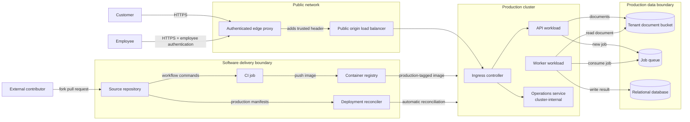

# Architecture

Arrows show allowed connections. The dashed boxes are trust or administrative boundaries.

The load balancer has a public DNS name in addition to the customer-facing edge hostname. The operations Service is `ClusterIP` and therefore not directly reachable from outside the cluster; its HTTP route is exposed through the same ingress and origin as the API.
